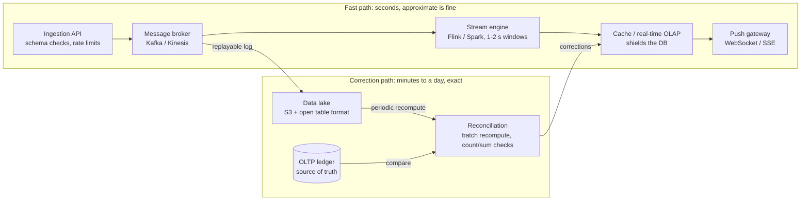

# Messaging and Real-Time Data Platforms: A Data Engineer's Reference

A reference for designing messaging and real-time data systems. It starts with fundamentals and vocabulary, then covers core concepts and common challenges. The last part compares the main alternatives at each layer on the same set of parameters.

## Contents

1. [Fundamentals](#1-fundamentals)
2. [Terminology](#2-terminology)
3. [Core concepts](#3-core-concepts)
4. [Challenges](#4-challenges)
5. [Key parameters for comparison](#5-key-parameters-for-comparison)
6. [Alternatives compared: brokers and streams](#6-alternatives-compared-brokers-and-streams)
7. [Alternatives compared: stream processing engines](#7-alternatives-compared-stream-processing-engines)
8. [Alternatives compared: serving](#8-alternatives-compared-serving)
9. [Alternatives compared: lake table formats and query engines](#9-alternatives-compared-lake-table-formats-and-query-engines)
10. [Choosing](#10-choosing)
11. [Practice questions](#11-practice-questions)
12. [References](#references)

---

## 1. Fundamentals

Messaging systems let services and data pipelines exchange events without waiting on each other. Event streams add a durable, replayable log, which is what real-time analytics is built on.

### Why messaging exists

In a synchronous design, service A calls service B and waits. If B is slow, A is slow. If B is down, A fails. Every new consumer is one more call A has to make. A broker between them removes those dependencies:

- **Decoupling:** producers don't know who consumes or how many consumers exist.
- **Buffering:** bursts are absorbed and drained at the consumer's pace.
- **Independent failure and scaling:** each side can be down, slow or scaled without the other noticing.
- **Fan-out:** one event can trigger many downstream actions.

The cost is **eventual consistency**: the consumer acts later, possibly twice, possibly out of order. Most of the concepts in this post exist to manage that cost.

| | Synchronous (REST, gRPC) | Asynchronous (broker) |
| --- | --- | --- |
| Coupling | Tight: caller waits for callee | Loose: producer sends and moves on |
| Failure | Callee outage breaks caller | Messages wait in the broker |
| Latency | One round trip, immediate answer | Usually ms to seconds, no direct answer |
| Consistency | Immediate | Eventual; duplicates and reordering possible |
| Fits | Queries, user-facing reads, commands needing a reply | Notifications, background work, data pipelines |

### From integration to analytics

The same machinery serves two purposes:

- **Service integration (event-driven architecture):** events trigger actions. Queues and pub/sub dominate here (SQS, SNS, RabbitMQ, EventBridge).
- **Data streaming:** events are data to be stored, replayed, joined and aggregated. Event streams dominate (Kafka, Kinesis), feeding stream processors and real-time stores.

### The governing question: how wrong are you allowed to be?

The usual whiteboard answer to "handle a huge traffic spike in real time" is a list of tools: a broker, a stream processor, WebSockets and a cache. The tools are easy to name. The design starts with the **correctness budget**: how much error, delay and loss the business can accept.

Compare two workloads that use the same pipeline:

- **A live engagement counter** (reactions, votes, view counts during a live event). If the count is off by a few thousand, nobody notices. You can aggregate approximately, acknowledge clients before data is durable, and drop late events.
- **Payment settlement.** One missing unit of currency is an incident, an audit finding and possibly a regulatory problem. Every event must be accounted for and reconciled.

| Dimension | Engagement signal | Money movement |
| --- | --- | --- |
| Acceptable error | Approximate | Zero; everything reconciles |
| Delivery semantics | At-most-once or at-least-once | Effectively-once end to end, plus reconciliation |
| Ack timing | Before durable write is acceptable | Only after a durable, replicated write |
| Aggregation | In-memory windows, sketches, sampling | Exact sums, idempotent upserts |
| Late or duplicate data | Drop or ignore | Detect, deduplicate, correct |
| Source of truth | The stream | The OLTP ledger; streams are derived views |
| Failure response | Degrade, show stale data | Block, alert, replay, reconcile |

### The reference pipeline

A typical real-time platform has a fast path that feeds screens in seconds and a slower path that makes the numbers right.

| Layer | Problem it solves | Without it |
| --- | --- | --- |
| Ingestion API | One validated, rate-limited entry point | Bad schemas and abusive clients reach every consumer |
| Message broker | Absorbs bursts, decouples producers from consumers, enables replay | Spikes hit databases directly; a bug means lost data |
| Stream engine | Aggregates in memory per window | Every reader recomputes from raw events |
| Cache / real-time OLAP | Serves reads in milliseconds | Millions of readers hit the primary database |
| Push gateway | One update fanned out to all clients | Polling multiplies load by the number of viewers |
| Lake + reconciliation | Exact recompute, audit, backfill | Streaming errors become permanent |

For engagement data the correction path can be thin or absent. For financial data it is mandatory.

---

## 2. Terminology

| Term | Layer | Meaning | Example |
| --- | --- | --- | --- |
| Event / message | Messaging | A record of a state change or action | `order_placed` |
| Producer / publisher | Messaging | System that emits events | Checkout service |
| Consumer / subscriber | Messaging | System that receives and processes events | Fraud scorer |
| Messaging system | Messaging | Umbrella term for asynchronous message exchange between components | Any of the below |
| Message broker | Messaging | Middleman that stores and routes messages between producers and consumers | RabbitMQ, SQS, Kafka |
| Queue | Messaging | 1:1 delivery; each message handled by one consumer and deleted after ack | SQS, RabbitMQ queue |
| Topic | Messaging | Named channel; every subscriber receives each message | SNS topic, Kafka topic |
| Exchange | Messaging | RabbitMQ router that sends messages to queues by rule (fan-out, direct, topic, headers) | Fan-out exchange |
| Fan-out | Messaging | One message delivered to many destinations; pub/sub in practice | SNS to three SQS queues |
| Routing / filtering | Messaging | Directing messages by topic, header or content | SNS filter policy |
| Acknowledgement (ack) | Messaging | Consumer's signal that a message was processed | SQS DeleteMessage, Kafka offset commit |
| Visibility timeout | Messaging | Period a received SQS message is hidden from other consumers | 30 s default |
| Dead-letter queue (DLQ) | Messaging | Where messages go after repeated failures | SQS redrive policy |
| Event stream | Streaming | Append-only, retained, replayable log of events | Kafka, Kinesis |
| Partition / shard | Streaming | Ordered sub-log; the unit of parallelism and ordering | Kafka partition, Kinesis shard |
| Partition key | Streaming | Field hashed to choose the partition; same key, same partition | `customer_id` |
| Offset / sequence number | Streaming | A record's position in a partition | Offset 1,204,551 |
| Consumer group | Streaming | Consumers sharing a topic's partitions; each partition read by one member | `fraud-scorer-v2` |
| Consumer lag | Streaming | How far a consumer is behind the head of the log | 90 s behind |
| Retention | Streaming | How long records stay readable | Kinesis: 24 h to 365 days |
| Replay | Streaming | Re-reading past records by resetting position | Reset offsets to yesterday 09:00 |
| Log compaction | Streaming | Keep only the latest record per key | Kafka compacted topic for state |
| Backpressure | Streaming | Slowing or buffering when consumers can't keep up | Producer throttling |
| Event time / processing time | Processing | When it happened vs. when the job saw it | Tap at 20:01:03, seen at 20:01:09 |
| Window | Processing | Bounded slice of a stream for aggregation (tumbling, sliding, session) | 2-second tumbling window |
| Watermark | Processing | Assertion that events up to time T have arrived; lets windows close | Max event time minus 10 s |
| Late data | Processing | Events arriving after their window's watermark | A phone reconnects after losing signal |
| State / stateless | Processing | Whether a job keeps memory across events | A dedup set is state |
| Checkpoint | Processing | Consistent snapshot of state and source positions for recovery | Flink checkpoint every 60 s |
| Micro-batch | Processing | Processing small batches on a fixed interval | Spark trigger of 2 s |
| Delivery semantics | Processing | At-most-once, at-least-once, exactly-once | See section 3.3 |
| Idempotency | Processing | Applying the same event twice has the same effect as once | Upsert by `payment_id` |
| CDC | Storage | Capturing row changes from a database log as events | Debezium, Maxwell, AWS DMS |
| Outbox pattern | Storage | Write the business row and an event row in one transaction; CDC publishes the event | Payments service |
| Entity vs. event | Storage | Mutable record (latest state) vs. immutable fact | `orders` row vs. `order_shipped` |
| Open table format | Storage | ACID table layer over object storage | Delta Lake, Iceberg, Hudi |
| Medallion layout | Storage | Bronze (raw), silver (clean), gold (aggregated) | Lake on S3 |
| Real-time OLAP | Serving | Store answering slice-and-dice queries on fresh data in sub-second time | Druid, ClickHouse, Pinot |
| Rollup | Serving | Pre-aggregating rows at ingestion | 5:1 rollup |
| Sketch | Serving | Approximate structure for distinct counts or quantiles | HyperLogLog, Theta sketch |
| Push channel | Serving | Server sends updates to clients without polling | WebSocket, SSE, MQTT |
| Cache-aside | Serving | Read cache, fall back to DB, then fill the cache | Redis in front of Postgres |
| Reconciliation | Correctness | Comparing derived numbers with the source of truth | Ledger vs. bank file |

---

## 3. Core concepts

### 3.1 Messaging patterns

| Pattern | Delivery model | Retention and replay | Built for | Examples |
| --- | --- | --- | --- | --- |
| Message queue | 1:1; each message processed by one of several competing consumers | Until acknowledged, then deleted | Task distribution, work queues | SQS, RabbitMQ |
| Publish-subscribe | 1:many; every subscriber gets a copy | Usually none after delivery | Broadcasting, triggering several actions | SNS, EventBridge, RabbitMQ fan-out |
| Event stream | Many independent consumers, each tracking its own position | Durable log retained for a period; any consumer can replay | Real-time analytics, reprocessing, windowed aggregation | Kafka, Kinesis, Pulsar |

Queues and pub/sub were designed for service integration; streams for durable, high-throughput, replayable data. The lines are blurring: Kafka 4.0 added early-access queue semantics, and RabbitMQ added a Streams feature. Production systems also combine patterns, for example SNS to SQS for fan-out with buffering.

### 3.2 Characteristics of a messaging system

| Characteristic | Meaning | Design note |
| --- | --- | --- |
| Ordering | Delivered in production order | Per partition, shard or message group; never global at scale |
| Retention | How long messages stay available | Queue: until acked. Stream: time- or size-based |
| Replay | Re-read after consumption | Needs retention plus consumer-controlled position |
| Routing | Directing by topic, header or content | Filter in the broker to save consumer work |
| Continuity | Continuous flow vs. intermittent events | Shapes batching and the pricing model |
| Real-time | Delivered as it happens | Measure end-to-end latency, not broker latency |
| Durability | Survives broker or consumer crashes | Replication, acks, persistent storage |
| Scalability | More messages, producers and consumers | Partitioning, parallel reads within a consumer, more instances |
| Protocol | How clients talk to the broker | AMQP (RabbitMQ, ActiveMQ), MQTT (IoT), Kafka binary protocol, HTTPS (SQS, SNS, Kinesis) |

### 3.3 Delivery semantics and idempotency

| Guarantee | Meaning | How it's achieved | Fits |
| --- | --- | --- | --- |
| At-most-once | 0 or 1 times; loss possible | Ack or commit before processing; fire-and-forget producer | Engagement counters, sampled telemetry |
| At-least-once | Never lost; may duplicate | Process, then ack; retry on failure | Most analytics and logs |
| Exactly-once (effectively-once) | Each event affects the result once | Idempotent producer, transactions, transactional or idempotent sink | Payments, billing, inventory |

Exactly-once in Kafka or Flink covers only the read-process-write loop inside the system. End to end you also need a replayable **source** and an idempotent or transactional **sink**. Most production systems are at-least-once plus idempotent writes, using one or more of these patterns:

- **Upsert by business key** (`payment_id`) instead of a blind insert.
- **Dedup state** of seen event IDs, with a TTL at least as long as the replay window.
- **Deterministic event IDs** derived from content plus source position, so retries produce the same ID.
- **Version checks:** apply an update only if `incoming.version > stored.version`. This protects against out-of-order CDC.

### 3.4 Partitioning, ordering and scaling

- Partitions are the unit of parallelism and of ordering. Consumer parallelism is capped at the partition count.
- The partition key decides both ordering and skew. Keying by `customer_id` keeps one customer's events ordered but can put a very large customer on one hot partition. Fixes include higher-cardinality keys, salting with a later re-aggregation, or isolating hot keys.
- Inside a consumer, process partitions in parallel with threads or worker pools while keeping per-key order.
- Partition counts are hard to change during peak load, so size them for the peak.

### 3.5 Time, windows and state

Stream processing is mostly about deciding when a result is complete.

- **Event time vs. processing time:** mobile clients on poor networks produce large gaps between the two.
- **Watermarks** close windows. Too tight drops late events; too loose adds latency and state.
- **Allowed lateness and side outputs** keep late events for correction instead of silently dropping them.
- **Window types:** tumbling (counts every 2 seconds), sliding (5-minute error rate updated every 30 seconds), session (user journeys).
- **State** (counts, joins, dedup sets) lives in memory or RocksDB. **Checkpoints** snapshot state and source offsets together so recovery doesn't double-count. **State TTL** bounds growth.

### 3.6 Serving: push and caching

With millions of concurrent viewers, polling every 2 seconds means millions of identical requests per second. Push turns that into one fan-out per update.

Caching is often the biggest scaling lever. Useful patterns:

- Cache-aside, write-through and write-behind.
- **Pre-computed, pre-serialized values** in an in-memory store, so the hot path does no computation or encoding.
- HTTP **ETag / 304 Not Modified** responses to save bandwidth on mobile networks.
- Small, rarely changing reference tables held in process memory.
- Stampede protection: single-flight requests, jittered TTLs, stale-while-revalidate.

A cache is never the source of truth for money. Show balances from the ledger, or label cached values with their as-of time.

### 3.7 CDC, entities vs. events, and the lake

Separate data into two kinds. **Entities** (orders, payments, accounts) are mutable records: capture them with CDC and **upsert**. **Events** are immutable facts: **append** them. Land both in a lake, where exact recomputation, audits, backfills and ML training happen.

- **Outbox pattern:** write the business row and an outbox row in one transaction, then let CDC publish the outbox. This removes the inconsistency of writing to a database and a broker separately.
- **CDC ordering:** apply DDL and DML in their original order, using binlog position plus a schema registry.
- **Medallion layout** on an open table format. Compaction fixes the small files that streaming creates.
- **Replay and backfill:** deterministic logic, idempotent sinks and event-time windows let any job rerun from an offset or snapshot and produce the same result.
- **Reconciliation** for financial data: count and sum checks per window, nightly batch correction, three-way reconciliation (internal ledger, bank or partner files, gateway reports) and lineage.

---

## 4. Challenges

| Challenge | First symptom | Mitigations |
| --- | --- | --- |
| Traffic spikes | Consumer lag climbs when an event or sale starts | Size partitions and consumers for peak; pre-scale before scheduled events; rate-limit and shed low-value traffic |
| Hot partitions / skew | One partition or task far behind the rest | Higher-cardinality keys, salting plus re-aggregation, isolate hot keys |
| Too few partitions | Lag that more consumers can't fix | Repartition on unique IDs; plan partition count up front |
| Duplicates | Inflated counts after retries or restarts | Idempotent producer, upserts by business key, dedup state |
| Data loss | Totals lower than the source | `acks=all`, replication factor 3, ack clients only after a durable write, reconciliation |
| Out-of-order and late events | Windows missing events; wrong state after CDC | Event-time windows, watermarks, allowed lateness, version checks |
| Dual writes | Database and stream disagree | Outbox pattern plus CDC |
| Schema drift | Consumers crash or silently drop fields | Schema registry with compatibility rules; validate at ingestion; DLQ invalid events |
| Small files in the lake | Slow queries over streaming output | Compaction and clustering; larger trigger intervals |
| Replica lag | CDC delay tracks database replica delay | Monitor replica lag as an SLI; read the primary's log where justified |
| Reconnect storms | Backend overload after a deploy or network blip | Jittered backoff, snapshot-on-reconnect from cache, gateways sized for peak |
| Expensive or rogue queries | Real-time store destabilized | Query-governance proxy; workload-isolated clusters |
| High cardinality | Real-time store slows or bloats | Cap dimensions per event; rollup; sketches |
| Spot interruptions and cost | Failed jobs, rising bills | Drivers on On-Demand and executors on Spot; diversified instance fleets; Graviton |
| Operating the broker | Team time consumed by upgrades and rebalancing | Managed services (MSK, Confluent Cloud, Kinesis) |
| Testing consumers | Regressions visible only in production | Canary consumer group on a slice of traffic; compare outputs before cutover |
| Silently wrong numbers | Dashboards look fine but are wrong | Freshness, volume, completeness and distribution checks; lineage |
| Over-engineering | Many systems to run for a problem that needed an index | Fix code and queries first; scale vertically before horizontally |

---

## 5. Key parameters for comparison

Compare options on these parameters, roughly in this order. The first four usually eliminate most candidates. Sections 6 to 9 use the same parameters.

| # | Parameter | What to ask | Why it matters |
| --- | --- | --- | --- |
| 1 | Delivery model | Queue (1:1), pub/sub (1:many), or replayable stream? | Decides whether many teams can read the same data independently |
| 2 | Delivery guarantee | At-most, at-least or exactly-once? Transactions? | Sets how much dedup and reconciliation you must build |
| 3 | Ordering | Global, per key/partition/group, or none? | Wrong ordering corrupts state (balances, CDC) |
| 4 | Retention and replay | How long, and can consumers rewind? | Your recovery window for bugs and backfills |
| 5 | Throughput | Sustained and peak msgs/s and MB/s; per-partition limits | Must cover the peak, not the average |
| 6 | Latency | p50 and p99 end to end under peak load | Push vs. poll, batching and micro-batching all add delay |
| 7 | Scaling model | Partitions, shards or serverless? Can you rescale without downtime? | Rebalancing at peak is a common cause of outages |
| 8 | Fan-out | How many independent consumers, and does each get dedicated throughput? | Limits on readers per stream |
| 9 | Message size | Maximum payload per message or record | Large payloads need the claim-check pattern (store in S3, send a pointer) |
| 10 | Routing and filtering | Topic, header or content filtering in the broker? | Moves work off consumers |
| 11 | Failure handling | Retries, DLQ, poison-message handling | Decides what happens to bad data |
| 12 | Durability and HA | Replication, multi-AZ, multi-region | Loss risk and disaster recovery |
| 13 | Ecosystem | Connectors, stream processing, schema registry, client languages | Integration effort |
| 14 | Operational burden | Self-managed, managed or serverless | Team time is often the largest cost |
| 15 | Cost model | Per request, per shard-hour, per GB, per broker | The same workload can cost very different amounts |
| 16 | Security and governance | Encryption, IAM/ACLs, data residency, audit | Payment and personal data carry regulatory requirements |

For stream processors, add event-time support, state size and backend, checkpointing, SQL support and latency model. For serving stores, add query latency under concurrency, ingestion freshness, upsert support, cardinality handling and approximate functions.

---

## 6. Alternatives compared: brokers and streams

Use queues and pub/sub to integrate services. Use a replayable stream when data must be reprocessed or read by many teams.

### 6.1 AWS-native services

| Parameter | SQS | SNS | EventBridge | Kinesis Data Streams |
| --- | --- | --- | --- | --- |
| Delivery model | Queue (1:1) | Pub/sub (1:many) | Event bus with rules (1:many) | Replayable stream |
| Guarantee | At-least-once (standard); exactly-once processing with FIFO dedup | At-least-once; FIFO topics dedup | At-least-once | At-least-once; dedup downstream |
| Ordering | Best effort (standard); per message group (FIFO) | None (standard); per message group (FIFO) | Not guaranteed | Per shard (partition key) |
| Retention and replay | Up to 14 days, deleted on ack, no replay | None (FIFO topics can archive and replay) | Archive and replay | 24 h default, up to 365 days; replay from any point |
| Scaling | Automatic | Automatic | Automatic | Shards (1 MB/s or 1,000 records/s in, 2 MB/s out each) or on-demand |
| Fan-out | No (combine with SNS) | Up to 12.5M subscriptions per standard topic | Several targets per rule | 20 enhanced fan-out consumers (50 in On-demand Advantage) |
| Max message | 1 MiB | 256 KiB default, up to 1 MiB with the topic's `MaximumMessageSize` | Small events (use claim check for large) | Up to 10 MiB per record |
| Routing | None | Subscription filter policies | Content-based rules, schema registry, SaaS sources | Partition key only |
| Failure handling | Visibility timeout, redrive to DLQ | Retries, DLQ per subscription | Retries, DLQ per target | Consumer-managed checkpoints |
| Ops burden | None | None | None | Low |
| Best for | Work queues, buffering, retries | Notifications, fan-out | Cross-service and SaaS event routing | Real-time analytics, multiple replaying readers |

### 6.2 Open-source and managed brokers

| Parameter | Kafka (self-managed, MSK, Confluent) | Apache Pulsar | RabbitMQ / Amazon MQ | Northguard (LinkedIn) |
| --- | --- | --- | --- | --- |
| Delivery model | Replayable stream; early-access queue semantics in Kafka 4.0 | Stream and queue in one (exclusive, shared, failover, key-shared subscriptions) | Queues and exchanges; Streams feature for replay | Replayable log storage (Kafka replacement) |
| Guarantee | Exactly-once via idempotent producer and transactions | Effectively-once with dedup and transactions | At-least-once with publisher confirms | Not public in detail |
| Ordering | Per partition | Per partition or key | Per queue | Per range |
| Retention and replay | Configurable; unlimited with tiered storage | Tiered storage to object store | Until ack (queues); retained in streams | Retained log |
| Scaling | Partitions; rebalancing takes manual effort; KRaft removes ZooKeeper | Stateless brokers, storage in BookKeeper; easier rebalancing | Vertical plus clustering; lower ceiling | Log striping across segments; ranges split and merge; no partition rebalancing |
| Ecosystem | Largest: Connect, Streams, ksqlDB, Schema Registry, Flink | Smaller; Kafka-compatible options exist | AMQP, MQTT, STOMP plugins; many client libraries | Internal; Xinfra virtual topics span Kafka and Northguard |
| Ops burden | High self-managed; low on MSK Serverless or Confluent Cloud | High (brokers, bookies, metadata store) | Moderate; low on Amazon MQ | Not available outside LinkedIn |
| Best for | Default for high-throughput streaming and CDC | Multi-tenant, geo-replicated, mixed queue and stream workloads | Complex routing, priorities, legacy protocols | A signal of where Kafka strains at extreme scale |

Kafka-API-compatible alternatives (Redpanda, WarpStream, Confluent Freight) trade the JVM or local disks for lower latency or object-storage cost while keeping Kafka clients.

### 6.3 Why Kafka is fast

1. **Sequential I/O.** Kafka appends to a log and reads it in order, which disks and the OS page cache serve far faster than random access.
2. **Zero-copy reads.** Without zero-copy, serving a consumer copies data four times: disk to OS page cache, page cache to the Kafka process, process to socket buffer, socket buffer to network card. With `sendfile()`, the kernel copies straight from page cache to the network card and the application is skipped. This works because Kafka stores bytes on disk in the same format it sends over the wire. The benefit is lost when the broker must transform data, for example with TLS encryption or message-format down-conversion.
3. **Batching and compression** end to end, plus partitions for parallelism.

### 6.4 Northguard: why LinkedIn is replacing Kafka

LinkedIn, where Kafka was created, found Kafka hard to scale and operate at its size: reported as about 32 trillion records a day, 17 PB a day, 400K topics and 150 clusters. In 2025 it announced Northguard, a log storage system, and Xinfra, a virtualized pub/sub layer.

- **Log striping:** data is split into small segments spread across brokers, so there are no fixed partitions to rebalance and hot spots even out.
- **Ranges** replace fixed partitions and can split or merge as throughput changes.
- **Sharded metadata** replaces a single controller.
- **Xinfra** lets producers and consumers use virtual topics that span Kafka and Northguard clusters, so topics migrate without client code changes.

Kafka remains the standard for most companies. The lesson is to put a client abstraction layer between applications and the broker, so a future migration is possible.

### 6.5 Common AWS pairings

**SNS + Lambda vs. SQS + Lambda**

| Parameter | SNS | SQS |
| --- | --- | --- |
| Delivery mode | Push; retries per delivery policy | Pull; message kept until processed and deleted |
| Retries and DLQ | Retries, then an optional DLQ (an SQS queue) per subscription | Retries via visibility timeout; DLQ via redrive policy |
| Ordering | FIFO topics | FIFO queues |
| Fan-out | Yes | No |
| Batching | `PublishBatch` up to 10 messages on publish; Lambda gets one message per invoke | Up to 10 per receive; the Lambda event source batches more with a batching window |
| Use for | Broadcasting, real-time reactions | Durable, retryable task processing |

The common production pattern is **SNS → SQS → Lambda**: fan-out plus buffering plus retries.

**Kinesis Data Streams vs. SNS in front of Firehose**

Firehose buffers and delivers to S3, Redshift or OpenSearch, but it doesn't let several consumers read and replay the same data. Put Kinesis Data Streams first when you need replay, per-key ordering or several real-time readers. Use SNS to Firehose when you only need lightweight fan-out of notifications into the lake. SNS is usually cheaper at low or bursty volume because it charges per request. Kinesis charges for shard-hours or on-demand throughput plus retrieval, so compare the two at your actual volume.

---

## 7. Alternatives compared: stream processing engines

Flink is the default when you need millisecond latency, event-time correctness and large state. Spark Structured Streaming is the default when the team already runs Spark and second-level latency is fine. Kafka Streams fits when everything lives in Kafka and you want no extra cluster.

| Parameter | Apache Flink (incl. Amazon Managed Service for Apache Flink) | Spark Structured Streaming | Kafka Streams / ksqlDB | AWS Lambda on a stream |
| --- | --- | --- | --- | --- |
| Processing model | True streaming, event at a time | Micro-batch (continuous mode is limited) | Library inside your app, event at a time | Function per batch of records |
| Latency | Milliseconds | About 1 s and up | Milliseconds | Sub-second to seconds |
| Event time and watermarks | First-class; allowed lateness, side outputs | Supported; less flexible | Supported (grace periods) | You build it |
| State | Large keyed state in RocksDB; rescaling via key groups | RocksDB state store; moderate | RocksDB plus changelog topics in Kafka | None (use an external store) |
| Exactly-once | Checkpoints plus two-phase-commit sinks | With idempotent or transactional sinks (e.g. Delta) | Kafka transactions, Kafka to Kafka | No; make handlers idempotent |
| SQL | Flink SQL | Spark SQL, same as batch | ksqlDB | No |
| Sources and sinks | Very broad | Very broad; strong lake integration | Kafka only | AWS event sources |
| Ops burden | High self-managed; low when managed | Moderate (EMR, Databricks, Glue) | Low: runs in your service | None |
| Choose when | Low latency, complex event-time logic, large state | Team knows Spark; unify batch and streaming; second-level latency is fine | Kafka-native microservices, simple aggregations | Small, stateless per-event work |

Micro-batching engines struggle when pushed to millisecond intervals; if you need that, use a true streaming engine. If seconds are fine, micro-batching with built-in aggregations is often simpler to run.

---

## 8. Alternatives compared: serving

Serving has two parts: a store that answers queries on fresh data, and a channel that delivers updates to clients. Choose the store by query shape and the channel by fan-out and direction.

### 8.1 Real-time OLAP stores and caches

| Parameter | Apache Druid | ClickHouse | Apache Pinot | TimescaleDB | Redis |
| --- | --- | --- | --- | --- | --- |
| Design | Segments, ingestion-time rollup, bitmap indexes | Columnar MergeTree, vectorized execution, high compression | Real-time and offline segments, star-tree index | Postgres with time-series hypertables | In-memory key-value |
| Query shape | Time-series slice and dice | Ad hoc aggregations, logs, wide events | User-facing analytics at high QPS | SQL on time series, joins | Key lookups, counters, leaderboards |
| Freshness | Seconds (Kafka/Kinesis indexing) | Seconds (Kafka engine, batched inserts) | Seconds (stream ingestion) | Seconds (upserts) | Immediate |
| Upserts | Limited | Via ReplacingMergeTree (eventual) | Supported | Native | Native |
| Approximate functions | Theta sketches, quantile sketches | uniq, quantiles | HLL, theta | Extensions | HyperLogLog |
| Ops burden | High (many node types) | Moderate; managed cloud available | High | Low to moderate; limited native clustering | Low; managed options |

Two design choices pay off at scale: cap the number of custom dimensions per event to control cardinality, and put a query-governance proxy in front of the store to block expensive queries before they reach it.

### 8.2 Client delivery protocols

| Parameter | Short polling | Long polling | Server-Sent Events | WebSockets | MQTT | gRPC streaming |
| --- | --- | --- | --- | --- | --- | --- |
| Direction | Client pulls | Client pulls; server holds the request | Server to client | Bidirectional | Bidirectional pub/sub via a broker | Unary, server, client or bidirectional streams |
| Transport | HTTP | HTTP | HTTP | TCP after HTTP upgrade | TCP (or WebSocket) | HTTP/2 |
| Load at scale | Highest: requests × viewers | High | Low | Low | Lowest; built for constrained devices | Low |
| Payload | Any | Any | Text events | Text or binary | Binary, tiny headers | Protobuf (binary, typed contracts) |
| Browser support | Universal | Universal | Native | Native | Via WebSocket bridge | Needs a gRPC-Web proxy |
| Best for | Low concurrency, simplicity | Fallback where sockets are blocked | Feeds, scores, dashboards | Live reactions, chat, trading tickers | Mobile and IoT at huge fan-out on poor networks | Service-to-service calls and streams |

**Where gRPC fits.** gRPC is a synchronous RPC framework, with streaming, for services talking to services. It replaces REST/JSON between internal services, with typed Protobuf contracts and lower overhead. It does not replace a broker: there is no retention, buffering or replay, and the caller still depends on the callee being up. Use gRPC for request/response and low-latency internal streams, and a broker for decoupled, durable delivery.

---

## 9. Alternatives compared: lake table formats and query engines

The lake behind the stream is where exact numbers live. The table format decides how well it absorbs streaming upserts; the query engine decides how quickly people can read it.

### 9.1 Open table formats

| Parameter | Delta Lake | Apache Iceberg | Apache Hudi |
| --- | --- | --- | --- |
| Origin and strength | Databricks; tight Spark integration | Netflix; engine-neutral, widest engine support | Uber; built for streaming upserts and CDC |
| Upserts / CDC | MERGE; deletion vectors | MERGE INTO; merge-on-read deletes | Native upserts; copy-on-write and merge-on-read tables |
| Layout optimization | OPTIMIZE, Z-order, liquid clustering | Hidden partitioning, partition evolution, rewrite actions | Clustering and compaction services |
| AWS support | EMR, Glue, Athena | Athena, EMR, Glue, Redshift, S3 Tables | EMR, Glue, Athena |

### 9.2 Query engines on the lake

| Parameter | Trino / Presto (self-run) | Amazon Athena | Spark SQL (EMR) |
| --- | --- | --- | --- |
| Best for | Interactive SQL, BI, federated queries | Serverless ad hoc SQL | Heavy ETL, large joins, ML prep |
| Latency | Seconds | Seconds to minutes | Minutes |
| Ops burden | High: clusters, gateway, autoscaling, cache | None | Moderate |
| Cost model | Cluster time | Per TB scanned | Cluster time (Spot helps) |

Practices that generalize for self-run query engines and Spark:

- Isolate workloads (BI, scheduled ELT, ad hoc) in separate clusters so one can't starve another.
- Put a shared, remote cache over object storage for data and file metadata; keep it separate from compute so losing Spot nodes doesn't empty it.
- Keep clusters in one AZ per workload to avoid cross-AZ transfer cost.
- Generic container autoscalers tend to thrash on query engines; scale on query-queue signals instead.
- For Spark on EMR: Graviton instances, Spot for executors with drivers on On-Demand, diversified instance fleets, and explicit executor sizing where dynamic allocation adds overhead.

---

## 10. Choosing

Ask five questions in order before naming a tool.

1. **How wrong can the answer be?** Approximate (engagement), bounded (operational metrics) or exact (money).
2. **How fresh must it be?** Sub-second, seconds, minutes or next day. Many "real-time" requests are really minutes.
3. **What is the peak, and is it predictable?** Peak msgs/s, concurrent readers, and whether you can pre-scale.
4. **What is the source of truth, and how do we reconcile to it?** If you can't answer, the design isn't finished.
5. **What is the simplest design that meets 1 to 4, and what does it cost per event?** Fix code and queries first; add systems last.

### Patterns by correctness budget

| Budget | Ingest | Process | Store and serve | Correctness controls |
| --- | --- | --- | --- | --- |
| Approximate | Async producer, batching, sampling | Micro-batch or streaming engine; tumbling windows; sketches | Cache plus push (WebSocket, MQTT, SSE) | Volume monitoring; small loss tolerated |
| Bounded (operational) | `acks=all`, schema validation | Flink or Kafka Streams with watermarks and allowed lateness | Druid, ClickHouse or Pinot | Freshness and volume SLIs; late-data side outputs |
| Exact (financial) | Outbox plus CDC, idempotent producer | Exactly-once processing, dedup by business key | Upsert tables (Delta, Hudi, Iceberg); the OLTP ledger stays the truth | Count/sum reconciliation, nightly batch correction, audit lineage |

### Quick picks

| Need | Start with |
| --- | --- |
| Background jobs with retries | SQS with a DLQ |
| Notify several services of one event | SNS to one SQS queue per service, or EventBridge for content-based routing |
| Many teams replaying the same high-volume data | Kafka (MSK) or Kinesis Data Streams |
| Stream into S3 with no processing | Amazon Data Firehose |
| Event-time aggregations with large state | Flink (Amazon Managed Service for Apache Flink) |
| Second-level aggregations, team knows Spark | Spark Structured Streaming |
| Sub-second slice-and-dice dashboards | Druid, ClickHouse or Pinot |
| Live updates to millions of clients | Push gateway (WebSocket or MQTT) fed from a cache |
| Service-to-service request/response | gRPC or REST, not a broker |

---

## 11. Practice questions

- Design live reactions for 25 million concurrent viewers. Where do you accept loss, and why?
- Reuse that pipeline for a real-time payment settlement dashboard. What changes?
- Pick SQS, SNS, EventBridge or Kinesis for four different scenarios and justify each on the section 5 parameters.
- When does SNS to SQS beat Kinesis in front of Firehose, and when does it not?
- Consumer lag climbs from 2 s to 90 s when a big event starts. Walk through diagnosis and mitigation.
- Explain why Kafka exactly-once doesn't guarantee exactly-once into S3 or a REST API.
- One customer drives 30% of traffic and creates a hot partition. Give three fixes and their trade-offs.
- Druid, ClickHouse or Pinot for a user-facing analytics page: how do you choose?
- How would you detect that a CDC pipeline silently dropped 0.01% of updates?
- gRPC or a broker between two internal services? State the deciding factors.
- When would you *not* add a stream processor?
- Cut a Spark-on-EMR bill by 20% without slowing SLA jobs. What do you check first?

---

## References

AWS limits (checked November 2026; verify before relying on them):

- [Kinesis Data Streams: changing the data retention period](https://docs.aws.amazon.com/streams/latest/dev/kinesis-extended-retention.html)
- [Kinesis Data Streams: quotas and limits](https://docs.aws.amazon.com/streams/latest/dev/service-sizes-and-limits.html)
- [Kinesis Data Streams: enhanced fan-out consumers](https://docs.aws.amazon.com/streams/latest/dev/enhanced-consumers.html)
- [Amazon SNS: publishing large messages](https://docs.aws.amazon.com/sns/latest/dg/large-message-payloads.html)
- [Amazon SNS: endpoints and quotas](https://docs.aws.amazon.com/general/latest/gr/sns.html)
- [Amazon SNS: dead-letter queues](https://docs.aws.amazon.com/sns/latest/dg/sns-dead-letter-queues.html)

Northguard and Kafka:

- [InfoQ: LinkedIn announces Northguard and Xinfra](https://www.infoq.com/news/2025/06/linkedin-northguard-xinfra/)
- [The company that created Kafka is replacing it with a new solution](https://blog.dataengineerthings.org/the-company-that-created-kafka-is-replacing-it-with-a-new-solution-386cd1c2dcc8)

Related posts in this repo:

- [Understanding messaging systems and data streaming](messaging_and_streaming.md)
- [Messaging patterns vs. messaging protocols](messaging_patterns_vs_protocols.md)
- [Kafka internals and design](kafka/kafka_internals_design.md)
